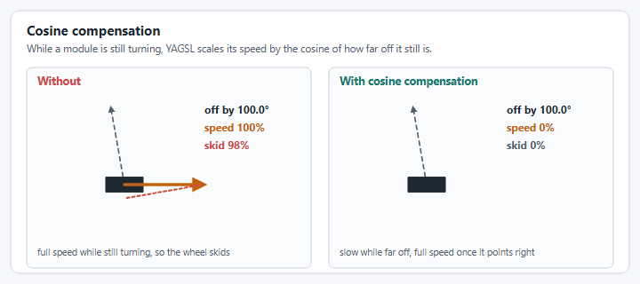

# Module Behaviors

YAMS's `SwerveModule`/`SwerveModuleConfig` provide a handful of behaviors beyond "go to this angle at this speed." This page explains what each one does and why it matters. Where a behavior is configurable, it's noted below. Several of these are currently hardcoded on by `SwerveParser` and are not yet exposed as JSON fields.

## Cosine Compensation

Cosine compensation scales the speed of your wheel by the cosine of the angle delta between the module's current angle and its commanded angle. While a module is still rotating to its target angle, driving it at full commanded speed wastes power and skids the wheel. Scaling speed down by how far off-angle the module still is keeps the wheel's actual velocity vector closer to what was commanded.

<figure><figcaption><p>Cosine compensation slows a module that is still turning.</p></figcaption></figure>


Cosine compensation is tuned for real hardware and can behave oddly in simulation, where the physics model doesn't reproduce the same wheel-slip behavior.


`SwerveModuleConfig` exposes this as `.withCosineCompensation(boolean)`. Today, `SwerveParser` always builds modules with cosine compensation **enabled** (`SwerveParser.createSwerveModule` hardcodes `.withCosineCompensation(true)`), and there is no JSON field to disable it. If you need it off (e.g. to compare behavior in simulation), you would need to construct the `SwerveModuleConfig` yourself rather than going through `SwerveParser`.

## Heading Correction / Heading-Snap Control

Heading correction keeps the robot facing a fixed heading while translating with no rotation input, or snaps to a heading chosen by a second controller axis. It used to be a JSON-configured PID (`controllerproperties.json`, driven by `SwerveController.headingCalculate`) that ran automatically inside `SwerveDrive.drive()`. **That class and JSON file no longer exist.**

Heading control now lives in your robot code via `SwerveInputStream` (`yams.commands2.swerve.SwerveInputStream` for Commands v2, `yams.commands3.swerve.SwerveInputStream` for Commands v3), and the PID gains for it are supplied directly in Java through `SwerveDriveConfig.withRotationController(PIDController)`:

```java
var cfg = new SwerveDriveConfig()
    .withRotationController(new PIDController(1.0, 0, 0))
    .withTranslationController(new PIDController(1.0, 0, 0));

// headingControlEnabled is a boolean your code toggles, for example from a button binding.
SwerveInputStream headingStream = angularVelocityStream.clone()
    .withControllerHeadingAxis(() -> -driver.getRightX(), () -> -driver.getRightY())
    .withHeadingControl(() -> headingControlEnabled);
```


YAMS stops any module asked for less than its velocity deadband (0.1 m/s by default), so a weak rotation gain leaves a small heading error the controller can never close. The YAGSL examples use a rotation `kP` of `3` and a translation `kP` of `4` for that reason.


This is a deliberate architectural change: heading control is now composed per-`SwerveInputStream` (you can have multiple drive modes with different heading behavior) rather than a single global toggle on `SwerveDrive`.

## Module Auto-synchronization

Absolute encoders and the motor controller's internal relative encoder can drift apart over a match (belt slip, CAN dropouts, etc). Auto-synchronization periodically re-zeros the internal encoder against the absolute encoder when the module has been at rest and the two disagree by more than a threshold.

This used to be a `SwerveDrive`-level toggle: `SwerveDrive.setModuleEncoderAutoSynchronize(boolean, double)`. It is now configured **per motor controller**, via `SmartMotorControllerConfig.withFeedbackSynchronizationThreshold(Angle)`:

```java
driveConfig.withFeedbackSynchronizationThreshold(Degrees.of(2));
```

Note this is currently only supported on REV SPARK-family controllers in YAMS. CTRE TalonFX/TalonFXS wrappers throw if you set this option, since those controllers handle absolute/relative fusion differently.

## Offset Offloading (External vs. Internal Feedback Sensor)

Offset offloading is where the absolute encoder position (or an attached absolute encoder's offset) is used directly as the motor controller's feedback sensor, instead of the SystemCore reading the absolute encoder and re-seeding a separate relative encoder in software. This usually means a faster, more direct control loop, at the cost of a little resilience if that sensor connection drops mid-match.


`SwerveDrive.pushOffsetsToEncoders()` and `SwerveDrive.restoreInternalOffset()`, the old toggle methods, no longer exist. They were deprecated as of YAGSL 2026 in favor of external/internal feedback sensor selection, and have since been removed along with the rest of the pre-JSON-wrapper API.


Today, `SwerveDriveConfig.useExternalFeedbackSensor()` is hardcoded to always return `true` in the current YAMS release, so external feedback (offset offloading) is always used when the absolute encoder and the azimuth motor controller come from the same vendor. That covers an encoder attached directly to the motor controller's data port, including one attached to a Thrifty Nova, and same-vendor CAN pairs such as a CANcoder with a TalonFX. `SwerveParser` hands the encoder to the motor controller as its external encoder, with `absoluteEncoderOffset` as the zero offset. When the vendors differ (for example a CANcoder with a SparkMAX), the absolute encoder is given to the YAMS `SwerveModule` instead, which reads it in robot code. There is no JSON field or builder setter to disable this yet.

## Auto-centering Modules

The old YAGSL had an "auto-centering" behavior (`SwerveDrive.setAutoCenteringModules`, `SwerveModule.setAntiJitter`) that snapped idle modules back to `0°` when no drive input was present. **This behavior could not be found anywhere in the current YAMS source**. It does not appear to have been ported to the new architecture. If your team relied on this, treat it as removed rather than renamed; open an issue if you need it back.

## Angular Velocity Compensation

The old YAGSL compensated for a known skew effect: when translating and rotating at the same time, a swerve drive's actual path bows away from the commanded path unless you correct for it (a technique pioneered by Jack-in-the-bot, enabled via `SwerveDrive.setAngularVelocityCompensation(boolean, boolean, double)`).

This has been ported to YAMS under a new name: `SwerveDriveConfig.withGyroAngularVelocityScaleFactor(double scaleFactor)`, with `withSimGyroAngularVelocityScaleFactor(double)` as a simulation-only override. Both take a `[0, 1]` scale factor applied to the gyro's angular velocity for skew correction, and require `SwerveDriveConfig.withGyroVelocity(Supplier<AngularVelocity>)` to be set. See [Swerve Drive Drift: Causes and Tuning Order](../reference/swerve-drift-causes.md) for where this fits in the tuning order, and note that [Chassis Speed Discretization](chassis-control.md) addresses a related but distinct skew problem.
