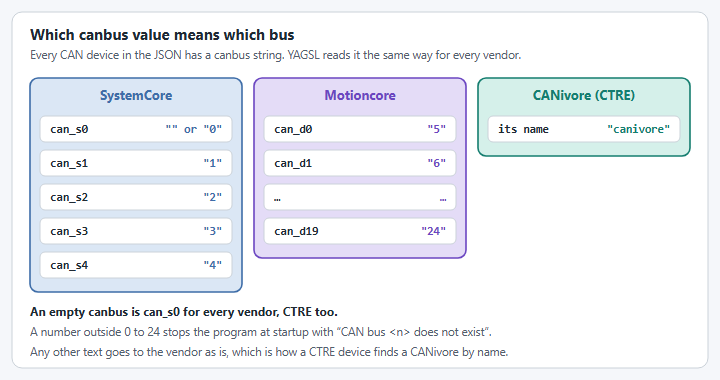

# How to put devices on a different CAN bus

The SystemCore has several CAN buses instead of one, so every CAN device in your YAGSL JSON (drive
and angle motors, absolute encoders, the gyro) has a `canbus` field saying which bus it is wired
to. YAGSL reads that field the same way for every vendor.


**Behavior change for CTRE devices.** An empty `canbus` now always means SystemCore bus `can_s0`,
for every vendor. Before, CTRE devices with an empty `canbus` ended up on Phoenix 6's own
SystemCore default, `can_s2`. If your TalonFX, CANcoder or Pigeon 2 devices are wired to `can_s2`,
they now need `"canbus": "2"`.


## 1. Find the bus each device is wired to

<figure><figcaption><p>Which canbus value means which bus.</p></figcaption></figure>

| `canbus` value        | Bus                                                                 |
| --------------------- | ------------------------------------------------------------------- |
| `""` (or left out)    | SystemCore `can_s0`                                                 |
| `"0"` to `"4"`        | SystemCore `can_s0` to `can_s4`                                     |
| `"5"` to `"24"`       | Motioncore `can_d0` to `can_d19`                                    |
| Any other text        | Passed to the vendor as is, for example a CANivore's name for CTRE  |

So a device on `can_s1` gets `"canbus": "1"`, and the first Motioncore bus, `can_d0`, is `"5"`.
A number outside 0 to 24 stops the robot program at startup with
`CAN bus <n> does not exist`.

## 2. Set `canbus` on each device

`canbus` is a string, so bus numbers are quoted:

```json title="modules/frontleft.json"
{
  "drive": { "type": "sparkflex_vortex", "id": 2, "canbus": "1" },
  "angle": { "type": "sparkmax_neo550", "id": 1, "canbus": "1" },
  "absoluteEncoder": { "type": "cancoder_can", "id": 10, "channel": 0, "canbus": "" },
  "inverted": { "drive": false, "angle": false },
  "absoluteEncoderOffset": -50.977,
  "location": { "front": 12, "left": 12 }
}
```

```json title="swervedrive.json"
{
  "gyro": { "type": "pigeon2_can", "id": 13, "canbus": "canivore" },
  "gyroAxis": "yaw",
  "gyroInvert": false,
  "modules": ["frontleft.json", "frontright.json", "backleft.json", "backright.json"]
}
```

Devices in one module don't have to share a bus, and neither do the modules.

## 3. Check what your vendor accepts

Not every vendor can use a bus name:

| Vendor                                                        | Accepted `canbus` values                                                                   |
| ------------------------------------------------------------- | ------------------------------------------------------------------------------------------ |
| CTRE (`talonfx_*`, `talonfxs_*`, `cancoder_can`, `pigeon2_can`) | Empty, a bus number, or a CANivore's name or serial number                                |
| REV (`sparkmax_*`, `sparkflex_*`, `splineencoder_can`)        | Empty or a bus number only                                                                 |
| Thrifty (`nova_*`)                                            | Empty or a bus number only                                                                 |
| Redux (`canandgyro_can`, `canandmag_can`)                     | Empty, a bus number, or a ReduxLib bus string such as `socketcan:can_s1`                   |
| Studica (`navx3_can`), AndyMark (`andymarkhexbore_can`)       | `canbus` is not used; the device is created from its CAN ID alone. Neither device works with YAGSL 2027 yet, because their vendor libraries have no `2027_alpha7` build                          |

That includes port names: a SPARK on `can_s1` is `"1"`, not `"CAN_S1"`. Giving a REV or Thrifty
device anything other than a bus number stops the robot program at startup with an
`IllegalArgumentException` like:

```
REV devices only use the Systemcore and Motioncore CAN buses, but canbus is "canivore". Use "" for can_s0, or the bus number, such as "1" for can_s1.
```

Encoders with an `_attached`, `_dio` or `_analog` type are not on CAN at all, so their `canbus` is
ignored. An `_attached` encoder is read through the angle motor controller, on that controller's
bus.

## 4. Verify it

Deploy and check the Driver Station console. A wrong bus doesn't stop the program the way a
malformed value does: the device is simply never found, so you get that vendor's usual "device not
detected" alerts and a module that doesn't respond. If one module or one vendor's devices are
missing, compare its `canbus` against the bus it is physically wired to before looking anywhere
else.
