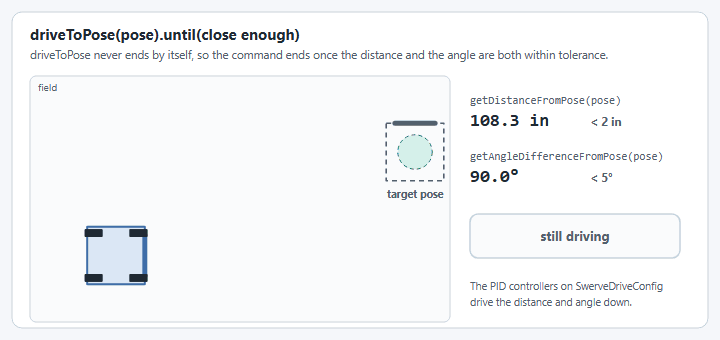

# How to drive to a pose

`SwerveDrive.driveToPose(Pose2d)` drives straight to a field-relative pose using two PID
controllers on `SwerveDriveConfig`. No path planning is involved, just "go here." It's a good fit
for short, single-target moves: aligning to a scoring location, a loading station, or a fixed
AprilTag-relative setpoint. For multi-point autonomous routines with obstacle-aware paths, see
[How to set up PathPlanner](setup-pathplanner.md) instead (Commands v2 only; on Commands v3
`driveToPose` is what you have).


`driveToPose` is **not compatible with AdvantageKit** replay (per its javadoc), because it reads
gyro/pose state live inside the command rather than through a logged input.


## 1. Give the drive translation and rotation controllers

`SwerveParser` doesn't set these for you. There's no JSON field for them, since they're a
robot-code concern, not a per-robot hardware description. Set them on the `SwerveDriveConfig`
before calling `createSwerveDrive(...)`:



```java title="SwerveDriveSubsystem.java"
import org.wpilib.math.controller.PIDController;
import swervelib.commands2.SwerveParser;
import yams.commands2.config.SwerveDriveConfig;
import yams.core.telemetry.SwerveDriveTelemetryConfig;
import yams.core.telemetry.enums.TelemetryVerbosity;

var cfg = new SwerveDriveConfig()
    .withStartingPose(new Pose2d(3, 3, Rotation2d.ZERO))
    .withSubsystem(this)
    .withTranslationController(new PIDController(4, 0, 0)) // input: meters of position error
    .withRotationController(new PIDController(3, 0, 0))    // input: radians of heading error
    .withTelemetry("swerve", new SwerveDriveTelemetryConfig(TelemetryVerbosity.HIGH));

SwerveParser.parse(new File(Filesystem.getDeployDirectory(), "swerve/base"));
drive = SwerveParser.createSwerveDrive(cfg);
```



```java title="SwerveDriveMechanism.java"
import org.wpilib.math.controller.PIDController;
import swervelib.commands3.SwerveParser;
import yams.commands3.config.SwerveDriveConfig;
import yams.core.telemetry.SwerveDriveTelemetryConfig;
import yams.core.telemetry.enums.TelemetryVerbosity;

var cfg = new SwerveDriveConfig()
    .withStartingPose(new Pose2d(3, 3, Rotation2d.ZERO))
    .withMechanism(this)
    .withTranslationController(new PIDController(4, 0, 0)) // input: meters of position error
    .withRotationController(new PIDController(3, 0, 0))    // input: radians of heading error
    .withTelemetry("swerve", new SwerveDriveTelemetryConfig(TelemetryVerbosity.HIGH));

SwerveParser.parse(new File(Filesystem.getDeployDirectory(), "swerve/base"));
drive = SwerveParser.createSwerveDrive(cfg);
```



The gains above are the YAGSL examples' placeholders, not values tuned for your robot. The
translation controller's output is a speed toward the target in meters per second; the rotation
controller's is radians per second. To use different gains in simulation, add
`withSimTranslationController(...)`/`withSimRotationController(...)`.


If a `driveToPose` command runs without both controllers set, YAMS throws a
`SwerveDriveConfigurationException` rather than silently picking a default, since an untuned
default would just as likely fight the robot as help it.



YAMS stops any module asked for less than 0.1 m/s (its default module velocity deadband), so a
rotation gain that's too low leaves the robot a few degrees short of the heading you asked for and
unable to close the rest. At `kP = 3` that dead zone is under 4.5 degrees.


The rotation controller is the same one `SwerveInputStream`'s heading control uses (see
[Heading Correction](../explanation/module-behaviors.md#heading-correction-heading-snap-control)).
If you've already tuned heading control, you have a reasonable starting point for `driveToPose`
too. Both controllers can be tuned live from a dashboard, see
[live tuning](tune-pidf-gains.md#live-tuning).

## 2. Wrap it in a command that knows when to stop

`driveToPose(Pose2d)` never finishes on its own. It keeps correcting toward the target pose until
something cancels it, the same way your teleop default command never finishes.

<figure><figcaption><p>The command ends once the robot is within both tolerances.</p></figcaption></figure>



Race it against a tolerance check (or a timeout) so it actually ends:

```java title="SwerveDriveSubsystem.java"
import static org.wpilib.units.Units.Degrees;
import static org.wpilib.units.Units.Inches;

public Command driveToPose(Pose2d pose) {
  return drive.driveToPose(pose)
      .until(() -> drive.getDistanceFromPose(pose).in(Inches) < 2
                && Math.abs(drive.getAngleDifferenceFromPose(pose).in(Degrees)) < 5);
}
```

`SwerveDrive.getDistanceFromPose(Pose2d)` and `getAngleDifferenceFromPose(Pose2d)` give you the
current translation/rotation error against any pose, so the tolerance check above works for any
target, not just the one you started the command with.



The Commands v3 `SwerveDrive` has a second overload that ends by itself once the robot is within
tolerance, and stops the drive when it ends or is canceled:

```java title="SwerveDriveMechanism.java"
import static org.wpilib.units.Units.Degrees;
import static org.wpilib.units.Units.Inches;

public Command driveToPose(Pose2d pose) {
  return drive.driveToPose(pose, Inches.of(2), Degrees.of(5));
}
```

To chain several poses, await each one inside a coroutine, the way the Commands v3 example's
`driveRelativeWaypoints` does:

```java
public Command driveSquare(List<Pose2d> poses) {
  return run(coroutine -> {
    for (Pose2d pose : poses) {
      coroutine.await(driveToPose(pose));
    }
  }).named("Drive Square");
}
```

`drive.isNear(pose, translationTolerance, rotationTolerance)` is the same check the overload
uses, if you want it in your own loop.


The tolerance overload ends as soon as the robot is inside the tolerance, even if it's still
moving. To settle on a final pose, finish with the plain `drive.driveToPose(pose)`, which holds
the pose until it is canceled.




If you'd rather hold at the pose indefinitely (for example while a button is held), skip the
tolerance and let whatever takes over next interrupt it. That's exactly what a bare
`drive.driveToPose(pose)` does.

## 3. Bind it



```java title="RobotContainer.java"
driverXbox.y().whileTrue(swerve.driveToPose(new Pose2d(3, 3, Rotation2d.fromDegrees(180))));
```



```java
driverXbox.y().whileTrue(robot.swerve.driveToPose(new Pose2d(3, 3, Rotation2d.fromDegrees(180))));
```



Pass a fixed pose for a known field feature, or a pose computed on the fly (from vision, or the
nearest of a set of candidate poses). `driveToPose` doesn't care where the `Pose2d` came from.


The pose is field-relative with the blue-alliance wall as the origin, `0°` facing the red alliance
wall, the same convention `SwerveDrive.getPose()`/odometry already use. If you're computing poses
per-alliance, flip them yourself for the red alliance; `driveToPose` does not.

