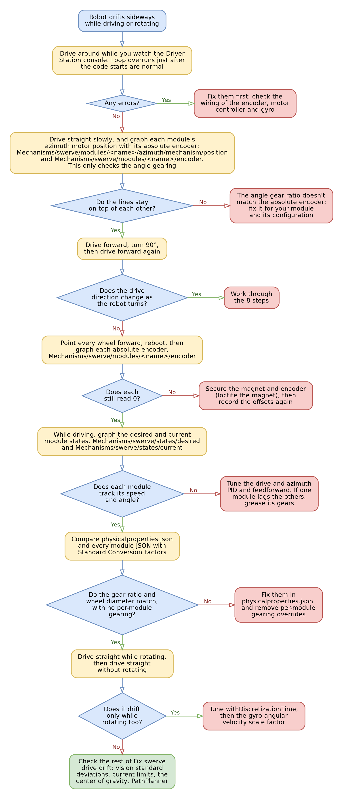
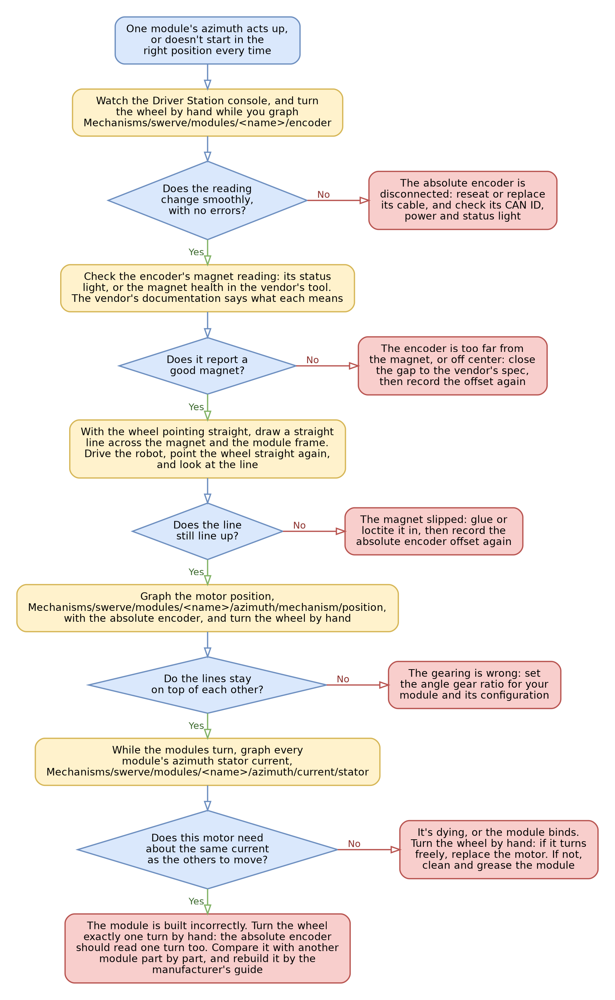

# Troubleshooting flowchart

Pick the chart that matches what your robot is doing, and follow it from the top. Each chart checks the quickest
causes first. The yellow boxes tell you how to check, and the blue question after each one asks what you saw. The links under each chart go to the pages its boxes mention.

* [Set up a robot with the config guide](#set-up-a-robot-with-the-config-guide)
* [Robot drives slower than it should](#robot-drives-slower-than-it-should)
* [Autonomous is consistently off](#autonomous-is-consistently-off)
* [Robot is drifting](#robot-is-drifting)
* [Wheels not pointing straight](#wheels-not-pointing-straight)
* [One module doesn't start in the right position](#one-module-doesnt-start-in-the-right-position)
* [Swerve modules spinning "out of control"](#swerve-modules-spinning-out-of-control)
* [Swerve module does not spin correctly](#swerve-module-does-not-spin-correctly)
* [Swerve drive "spins out of control"](#swerve-drive-spins-out-of-control)
* [Forward is not forward: the 8 steps](#forward-is-not-forward-the-8-steps)

Not sure which one? [Find your problem](fix-a-problem.md) matches symptoms to pages.

## Swerve drive diagram

<figure><figcaption></figcaption></figure>


Older gyroscopes like the Pigeon 1 and NavX 1 drift the longer they're powered on. Consider rebooting or zeroing your gyroscope at the start of your program.


## Set up a robot with the config guide

The config generator's [Quick Start Guide](https://config.yagsl.com/guide) takes a robot from a downloaded config to
driving, in nine steps. This is the same path, with the checks that send you to another chart.

<figure><figcaption>
The Quick Start Guide as a flowchart.
</figcaption></figure>

* Tuning in simulation: [Practice in simulation](../tutorial/practice-in-simulation.md)
* Inverting an absolute encoder: [Determine inversion](determine-inversion.md)
* Spinning the wrong way: [Swerve drive "spins out of control"](#swerve-drive-spins-out-of-control)
* Wrong at some headings: [Forward is not forward: the 8 steps](#forward-is-not-forward-the-8-steps)

## Robot drives slower than it should

<figure>/drive/measurement/velocity, with the desired states. Does the measured speed reach the desired speed? If no, tune the drive PID and feedforward. If yes, continue. Push the robot a measured distance, such as 3 m, and compare odometry, Mechanisms/swerve/pose. Does odometry agree? If no, the robot thinks it's faster than it is: check the gear ratio and measure the wheels. If yes, continue. Check how much free storage the SystemCore has left. Is it nearly full? If yes, delete old logs, then reboot the SystemCore. If no, continue. If every check passes: check the battery under load, and that statorCurrentLimit isn't set too low."><figcaption>
Robot drives slower than it should.
</figcaption></figure>

* The spin test, drive inversion and offsets: [Determine inversion](determine-inversion.md)
* Graphing the module states: [Set up AdvantageScope](set-up-advantagescope.md)
* Scaling the joystick and the maximum speed: [Chassis Control](../explanation/chassis-control.md#max-speed)
* Tuning the drive: [Practice in simulation](../tutorial/practice-in-simulation.md) and
  [Tune PIDF gains](tune-pidf-gains.md)
* Gear ratios and wheel diameters: [Standard Conversion Factors](../reference/standard-conversion-factors.md)

## Autonomous is consistently off

<figure><figcaption>
Autonomous ends short or long by about the same amount every time.
</figcaption></figure>

* Gear ratios and wheel diameters: [Standard Conversion Factors](../reference/standard-conversion-factors.md)
* Path following: [Fix swerve drive drift](../reference/swerve-drift-causes.md)

## Robot is drifting

<figure>/azimuth/mechanism/position and Mechanisms/swerve/modules/<name>/encoder. This only checks the angle gearing. Do the lines stay on top of each other? If no, the angle gear ratio doesn't match the absolute encoder: fix it for your module and its configuration. If yes, continue. Drive forward, turn 90°, then drive forward again. Does the drive direction change as the robot turns? If yes, work through the 8 steps. If no, continue. Point every wheel forward, reboot, then graph each absolute encoder, Mechanisms/swerve/modules/<name>/encoder. Does each still read 0? If no, secure the magnet and encoder (loctite the magnet), then record the offsets again. If yes, continue. While driving, graph the desired and current module states, Mechanisms/swerve/states/desired and Mechanisms/swerve/states/current. Does each module track its speed and angle? If no, tune the drive and azimuth PID and feedforward. If one module lags the others, grease its gears. If yes, continue. Compare physicalproperties.json and every module JSON with Standard Conversion Factors. Do the gear ratio and wheel diameter match, with no per-module gearing? If no, fix them in physicalproperties.json, and remove per-module gearing overrides. If yes, continue. Drive straight while rotating, then drive straight without rotating. Does it drift only while rotating too? If yes, tune withDiscretizationTime, then the gyro angular velocity scale factor. If no, continue. If every check passes: check the rest of Fix swerve drive drift: vision standard deviations, current limits, the center of gravity, PathPlanner."><figcaption>
Robot drifts sideways while driving or rotating.
</figcaption></figure>

* Wiring: [Fix swerve drive drift](../reference/swerve-drift-causes.md#hardware-causes)
* Angle gearing: [Standard Conversion Factors](../reference/standard-conversion-factors.md) and
  [One module doesn't start in the right position](#one-module-doesnt-start-in-the-right-position)
* Direction changes as the robot turns: [Forward is not forward: the 8 steps](#forward-is-not-forward-the-8-steps)
* Recording offsets: [Check and calibrate your hardware](../tutorial/04-verify-and-calibrate-hardware.md)
* Tuning the modules: [Practice in simulation](../tutorial/practice-in-simulation.md) and
  [Tune PIDF gains](tune-pidf-gains.md)
* Gear ratios and wheel diameters: [Standard Conversion Factors](../reference/standard-conversion-factors.md)
* Discretization, the gyro scale factor and everything else:
  [Fix swerve drive drift](../reference/swerve-drift-causes.md#tuning-order)

## Wheels not pointing straight

<figure>/encoder. Does each read 0? If no, record that module's absolute encoder offset again. If yes, continue. Graph the desired and current module states, Mechanisms/swerve/states/desired and Mechanisms/swerve/states/current. Does each module reach its angle? If no, tune the azimuth PID and feedforward. If yes, continue. Open a DataLog from a match, and graph the desired and current module states while the robot is pushed or turning hard. Do the modules fall behind their angle in a match, but not on blocks? If yes, the angle current limit is too low: raise statorCurrentLimit.angle in physicalproperties.json (the default is 20 A). If no, continue. If every check passes: only one module still acts up: see One module doesn't start in the right position."><figcaption>
Wheels don't all point straight when you drive straight.
</figcaption></figure>

* Device type strings: [Device Type Strings](../reference/json-schema/device-types.md)
* Module locations: [Verify your module locations](verify-module-locations.md)
* Recording offsets: [Check and calibrate your hardware](../tutorial/04-verify-and-calibrate-hardware.md)
* Tuning the azimuth: [Practice in simulation](../tutorial/practice-in-simulation.md)
* The device list and the Swerve tab: [Set up AdvantageScope](set-up-advantagescope.md)
* Reading a match log: [View your DataLog in AdvantageScope](view-your-datalog-in-advantagescope.md)
* Current limits: [physicalproperties.json](../reference/json-schema/physicalproperties-json.md)
* Only one module acts up: [One module doesn't start in the right position](#one-module-doesnt-start-in-the-right-position)

## One module doesn't start in the right position

When one module's azimuth acts up, or points somewhere different each time the robot starts, the problem is almost
always in that module's hardware or its gearing. Check the easy causes first: a module built incorrectly is the
last thing to suspect.

<figure>/encoder. Does the reading change smoothly, with no errors? If no, the absolute encoder is disconnected: reseat or replace its cable, and check its CAN ID, power and status light. If yes, continue. Check the encoder's magnet reading: its status light, or the magnet health in the vendor's tool. The vendor's documentation says what each means. Does it report a good magnet? If no, the encoder is too far from the magnet, or off center: close the gap to the vendor's spec, then record the offset again. If yes, continue. With the wheel pointing straight, draw a straight
line across the magnet and the module frame.
Drive the robot, point the wheel straight again,
and look at the line. Does the line
still line up? If no, the magnet slipped: glue or
loctite it in, then record the
absolute encoder offset again. If yes, continue. Graph the motor position, Mechanisms/swerve/modules/<name>/azimuth/mechanism/position, with the absolute encoder, and turn the wheel by hand. Do the lines stay on top of each other? If no, the gearing is wrong: set the angle gear ratio for your module and its configuration. If yes, continue. While the modules turn, graph every
module's azimuth stator current,
Mechanisms/swerve/modules/<name>/azimuth/current/stator. Does this motor need
about the same current
as the others to move? If no, it's dying, or the module binds.
Turn the wheel by hand: if it turns
freely, replace the motor. If not,
clean and grease the module. If yes, continue. If every check passes: the module is built incorrectly. Turn the wheel exactly one turn by hand: the absolute encoder should read one turn too. Compare it with another module part by part, and rebuild it by the manufacturer's guide."><figcaption>
One module's azimuth acts up, or doesn't start in the right position every time.
</figcaption></figure>

* What the magnet status light or reading means: your encoder's page under [Absolute Encoders](../reference/hardware/absolute-encoders.md), and the vendor's documentation
* Reading the absolute encoder and recording offsets: [Check and calibrate your hardware](../tutorial/04-verify-and-calibrate-hardware.md)
* Graphing the motor position with the absolute encoder: [Practice in simulation](../tutorial/practice-in-simulation.md)
* Angle gear ratios: [Standard Conversion Factors](../reference/standard-conversion-factors.md)
* A dying motor or a loose magnet: [Fix swerve drive drift](../reference/swerve-drift-causes.md#physical-components)

## Swerve modules spinning "out of control"

<figure><figcaption></figcaption></figure>

## Swerve module does not spin correctly

1. Are the CAN IDs, motor types, and absolute encoder types correct? See the [device reference](../reference/hardware/) for supported type strings.
2. Are the module `location`s correct?
3. Do you use an absolute magnetic encoder?
   1. Did you loctite the magnet in?
   2. Do you have a good (usually green LED) reading on the magnet?
4. Did you set `absoluteEncoderOffset` while the wheels had the bevel facing left and the wheel pointed straight front-to-back?
5. Did you check [how to determine inversion](determine-inversion.md) for inversion states?
6. Did you [tune your PID](tune-pidf-gains.md)?

If none of the above resolves it, move on to [the 8 steps](#forward-is-not-forward-the-8-steps).

## Swerve drive "spins out of control"

<figure><figcaption></figcaption></figure>

See [how to determine inversion](determine-inversion.md) and [the 8 steps](#forward-is-not-forward-the-8-steps).

## Forward is not forward: the 8 steps

When forward in real life isn't forward in odometry, or field-relative driving changes as the robot turns, the 8 steps
try every combination of gyro inversion, drive inversion and module order that can cause it. Somewhere along the way it
gets fixed. [Fix steering that changes as the robot turns](the-8-steps.md) has the drive code to test with, and how to
flip the modules.


Most of the steps make the robot spin out of control. Keep it somewhere safe and be ready to disable it.


<figure><figcaption>
The 8 steps as a flowchart.
</figcaption></figure>
