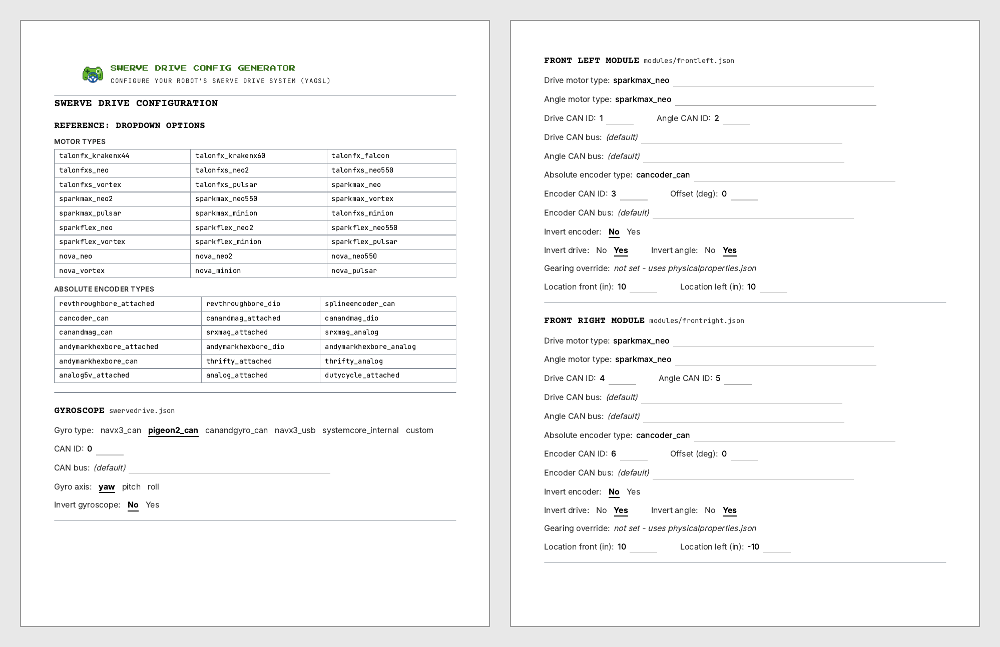

# 1. Gather your robot information

YAGSL is configured entirely from information about *your* robot. Every swerve drive is different,
even between robots using the same COTS modules, so don't assume your numbers match another team's
example.

Use the [config generator](https://config.yagsl.com) to collect it. It asks for everything YAGSL
needs, one tab at a time, and lists the options for each value.

## Prefer paper?

Click the generator's **Print** button and take the printout to the robot. Every tab prints with
its options listed and a blank line for each value, so you can fill it in as you go and type it into
the generator later.

<figure><figcaption>
The config generator's printout.
</figcaption></figure>

## CAN buses

The SystemCore has several CAN buses, so record which one each CAN device is wired to: `can_s0`
(the default) through `can_s4`. CTRE devices on a [CANivore](https://store.ctr-electronics.com/canivore/)
use the CANivore's name instead.

Every device's CAN bus is entered the same way, whichever vendor made it: leave it empty for
`can_s0`, or enter the bus number, `0` to `4` for `can_s0` to `can_s4` (so `1` is `can_s1`), and `5`
to `24` for the Motioncore buses `can_d0` to `can_d19`. Only CTRE devices also accept a CANivore
name. REV and Thrifty devices only accept a bus number. See
[Put devices on a different CAN bus](../how-to/choose-a-can-bus.md).

With this information in hand, move on to [installing YAGSL](02-install-yagsl.md).
