# Verify and calibrate your hardware

Before your first drive, confirm every sensor and motor reports direction consistently, capture each module's absolute encoder offset, and tune the modules. Skipping this step is the single most common cause of a swerve drive that "spins out" or drives in the wrong direction.

Work through the steps in order. Steps 2 and 10 are the same live tuning, first in simulation to learn it and then on the real robot, so the animations in step 2 apply to step 10 too.


The [config generator's Quick Start Guide](https://config.yagsl.com/guide) walks through this same process as interactive, printable checklists.




### Label every device and check the CAN IDs

Label each motor controller, encoder and the gyroscope with its type, CAN ID (or channel) and bus before you start. This is the easiest step to get wrong and the hardest mistake to spot afterward.

<figure>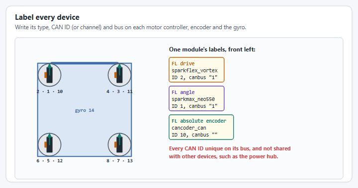<figcaption>
Label every device with its type, ID and bus.
</figcaption></figure>


Make sure every CAN ID is unique across your entire robot, and that each device's CAN bus in your config matches the SystemCore bus it is actually wired to (an empty `canbus` means `can_s0`). A known failure mode: if a SparkMAX shares a CAN ID with your REV Power Distribution Hub, the SparkMAX simply won't move, with no obvious error.




### Practice live tuning in simulation

Run the robot program in simulation and go through live tuning once before you touch the real robot. Simulation is practice, not tuning: the gains it finds can't be trusted on the real modules, but it teaches you the dashboard and catches config mistakes while nothing can break. Live tuning needs the swerve subsystem from [step 5](05-deploy-and-drive.md) with `TelemetryVerbosity.HIGH` and both drive-to-pose controllers; [Tune PIDF gains](../how-to/tune-pidf-gains.md#live-tuning) shows the setup.

**Start live tuning.** Enable Utility mode, start the tuning command under `Mechanisms/swerve/tuning`, and turn on one tuning mode. `Tuning/swerve/` values only take effect while the command runs.

<figure>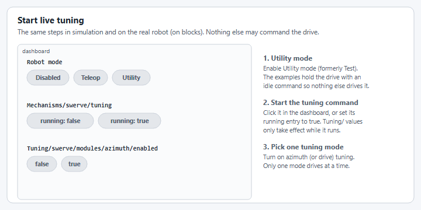<figcaption>
Utility mode, the tuning command, then one tuning mode.
</figcaption></figure>

**Tune the azimuth first**, so the wheels point where they are told while you tune the drive. Set `Tuning/swerve/modules/azimuth/enabled` to `true` and switch `modules/azimuth/angle` between `0` and `90`. Raise `feedback/p` until the modules snap to the angle; if they overshoot and shake, back it off and add a little `feedback/d`.

<figure>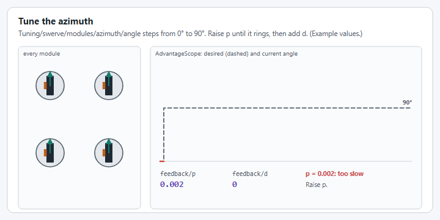<figcaption>
Too slow, ringing, then quick and settled. The values are only an example.
</figcaption></figure>

<figure>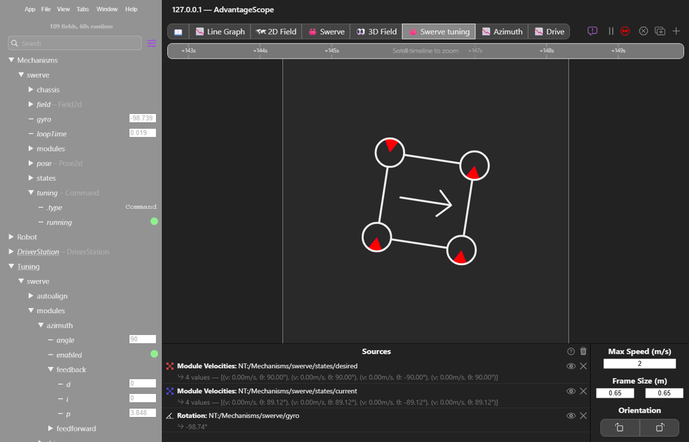<figcaption>
The real thing: azimuth tuning in AdvantageScope, every module at 90°.
</figcaption></figure>

<figure>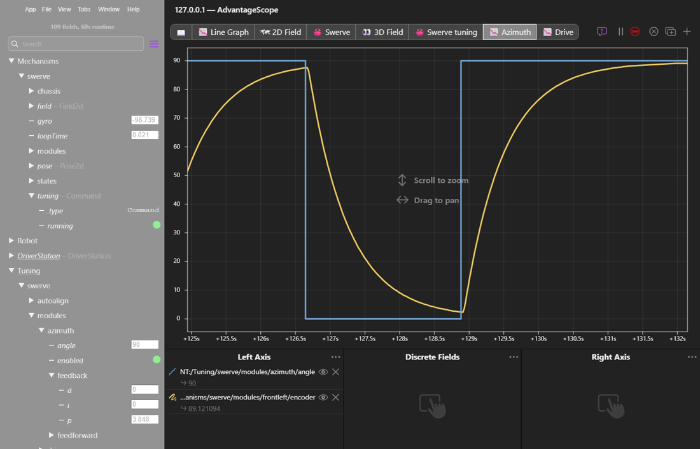<figcaption>
Graph Tuning/swerve/modules/azimuth/angle against a module's encoder to judge the gains.
</figcaption></figure>

**Then tune the drive.** Turn azimuth tuning off and set `modules/drive/enabled` to `true` with `modules/drive/velocity` at `2`. Zero `feedback/p`, raise `feedforward/v` until the velocity settles on 2 m/s, then add `feedback/p` until it gets there quickly and holds.

<figure>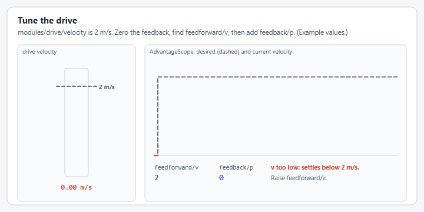<figcaption>
Feedforward first, then feedback. The values are only an example.
</figcaption></figure>

<figure>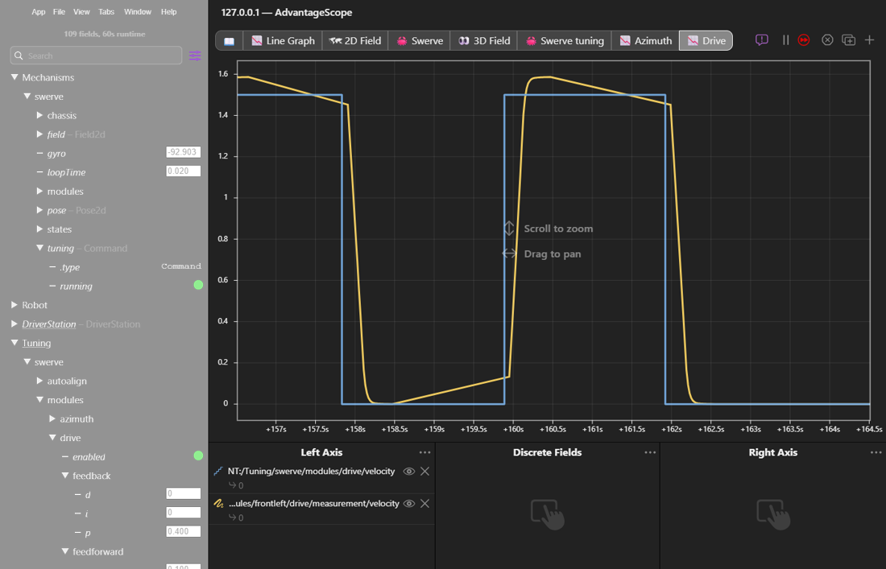<figcaption>
Graph Tuning/swerve/modules/drive/velocity against a module's drive/measurement/velocity.
</figcaption></figure>

**Save what you find.** Values typed on the dashboard are gone the next time the robot program starts. In simulation, copy them into `pidfproperties_sim.json`, which YAGSL reads only in simulation.

<figure>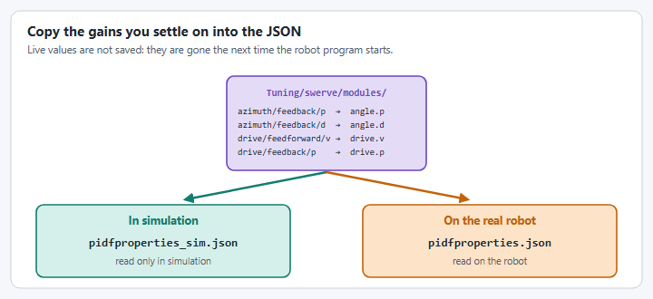<figcaption>
Where the live values belong.
</figcaption></figure>

[YAMS' live tuning page](https://yams.yassrobotics.com/documentation/understanding/live-tuning#swerve-drive) covers every swerve tuning key, `feedforward/s`, and auto-align tuning.



### Deploy, stay disabled, and open AdvantageScope

Deploy your code with the config from step 3 and **keep the robot disabled**. Open AdvantageScope's `Mechanisms/swerve` NetworkTables tree. The swerve subsystem from [step 5](05-deploy-and-drive.md) publishes these values, so if your project doesn't have one yet, add it first and come back. The `swerve` in the path is the name that code passes to `SwerveDriveConfig.withTelemetry("swerve", ...)`.

<figure><figcaption>
The Mechanisms/swerve tree in AdvantageScope. Each module's drive/azimuth telemetry and raw absolute encoder are visible per-module.
</figcaption></figure>


If you're using a hardware vendor client to poke at motors/encoders directly, your robot program must not be commanding those devices at the same time. Keep the robot disabled while you use the client, and power-cycle the robot when you're done so the SystemCore and your robot program start from a clean state.




### Pick a front and check the gyroscope

**Front is whatever the gyroscope reports as `0`.** Pick a front, and expect that you may need to change it later if it turns out to be inconvenient. Then lift the robot and turn it counterclockwise (seen from above): `Mechanisms/swerve/gyro` must go **up**. If it goes down, set `gyroInvert` to `true` in `swervedrive.json`.

<figure>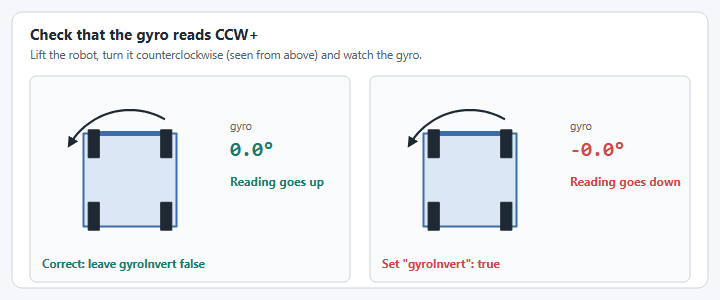<figcaption>
Turn the robot counterclockwise: the gyro should go up.
</figcaption></figure>

If you're using a NavX, recalibrate it once it arrives at your shop because NavX units ship calibrated to the humidity of their factory, not your build space. Recalibrate again periodically, especially at competition.



### Check each drive motor

Point the module forward, then roll its wheel forward by hand. That module's `modules/<name>/drive/measurement/position` (the distance the wheel has rolled, in meters) must go **up**. If it goes down, set `"inverted": { "drive": true }` in that module's JSON.

<figure>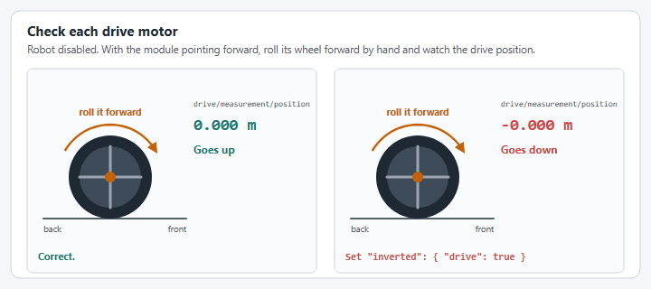<figcaption>
Roll the wheel forward: the drive position should go up.
</figcaption></figure>



### Check each angle motor and absolute encoder

Turn the module counterclockwise (seen from above) by hand. Both `modules/<name>/azimuth/mechanism/position` (relative, in rotations) and `modules/<name>/encoder` (absolute, in degrees) must go **up**.

* If the **encoder** goes down, set `"absoluteEncoderInverted": true`.
* If the **azimuth** position goes down, set `"inverted": { "angle": true }`.

<figure>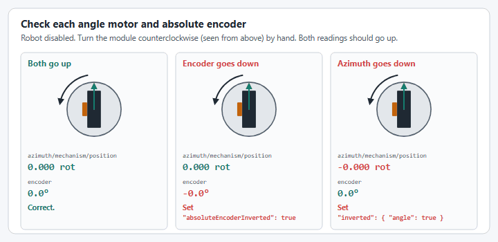<figcaption>
Turn the module counterclockwise: both readings should go up.
</figcaption></figure>

See [Determine Inversion](../how-to/determine-inversion.md) for the full decision procedure if any of these don't behave as expected.



### Align every wheel

Turn all four wheels by hand so they point forward, with their bevel gears facing the robot's left, and so rolling them forward makes the drive position go up.

<figure>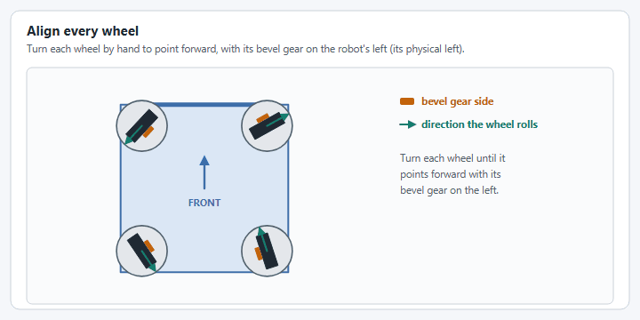<figcaption>
Every wheel forward, bevel gears on the left.
</figcaption></figure>

<figure><figcaption>
The left and right are physical left and right.
</figcaption></figure>



### Record each module's offset

With the wheels still aligned and the robot still disabled, read each module's `Mechanisms/swerve/modules/<name>/encoder` and enter it as that module's absolute encoder offset. Use the [config generator](https://config.yagsl.com) (recommended: upload your existing config, update the four offset fields, and re-download) or `absoluteEncoderOffset` in the module's JSON file.

<figure>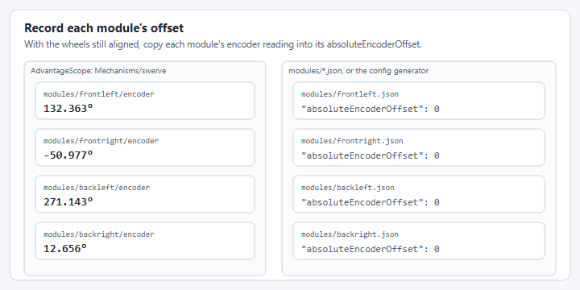<figcaption>
Each encoder reading becomes that module's offset.
</figcaption></figure>

The absolute encoder offset is what lets your swerve module remember wheel orientation across power cycles. Redeploy once all four are in.


**Special note for MAXSwerve teams:** after aligning the wheels, you may need to add or subtract `90` from the measured offset to get the module pointing truly forward, and set `absoluteEncoderInverted` to `true`. This is a quirk of how MAXSwerve mounts its absolute encoder, not a bug in your measurement.




### Run the spin test

With the robot lifted, command pure counterclockwise rotation and watch the modules in AdvantageScope's Swerve view. It should spin cleanly counterclockwise.

<figure>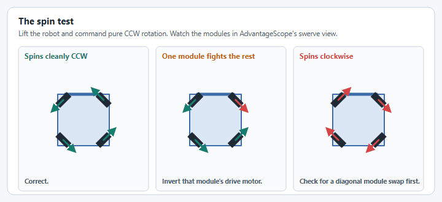<figcaption>
What the spin test can look like.
</figcaption></figure>

You can also run it from the dashboard: with drive tuning on, set `Tuning/swerve/modules/drive/inplace` to `true` and give `modules/drive/velocity` a small positive speed. Every module turns tangent to the robot and it should spin counterclockwise.

<figure>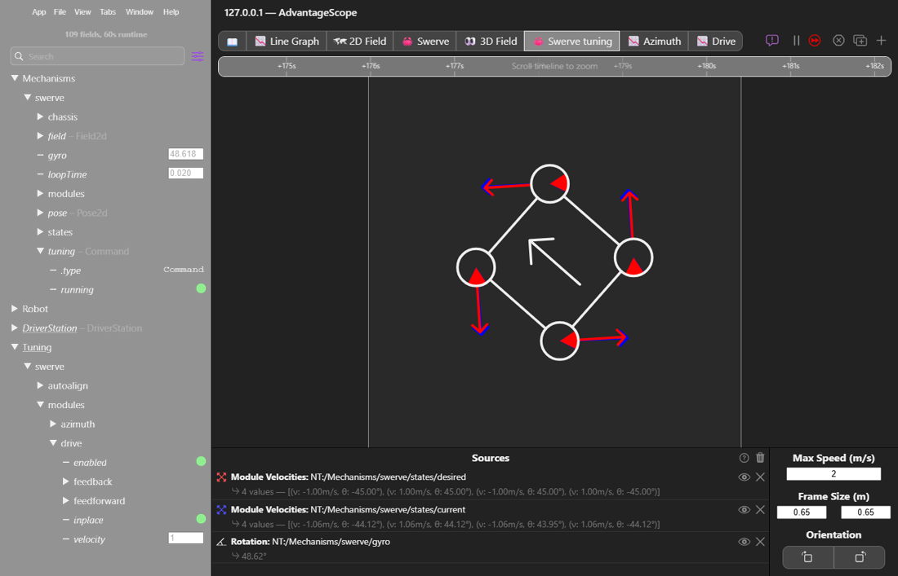<figcaption>
The spin test from the dashboard: modules/drive/inplace on, every module tangent to the robot.
</figcaption></figure>

[Determine Inversion](../how-to/determine-inversion.md) lists every symptom and its cause.



### Live tune on the real robot

Now do step 2 again for real, with the same dashboard and the same order: start live tuning, tune the azimuth, then the drive. The animations in step 2 show what to look for.

* **Lift the robot on blocks**, with every wheel clear of the blocks and of the ground. Tuning moves the modules.
* **Start from the gains in `pidfproperties.json`**, not the ones you found in simulation.
* **Copy what you settle on into `pidfproperties.json`**, the file the real robot reads.

<figure><figcaption>
On the real robot, the gains go into pidfproperties.json.
</figcaption></figure>



Once every module reports correctly, has a captured offset and is tuned, move on to [deploying and driving](05-deploy-and-drive.md).
