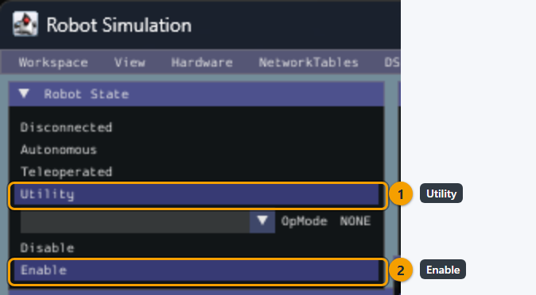
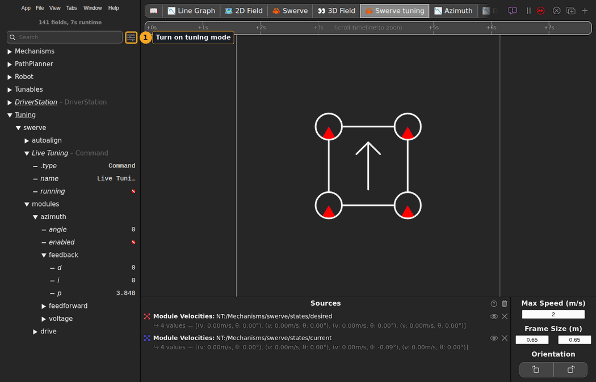
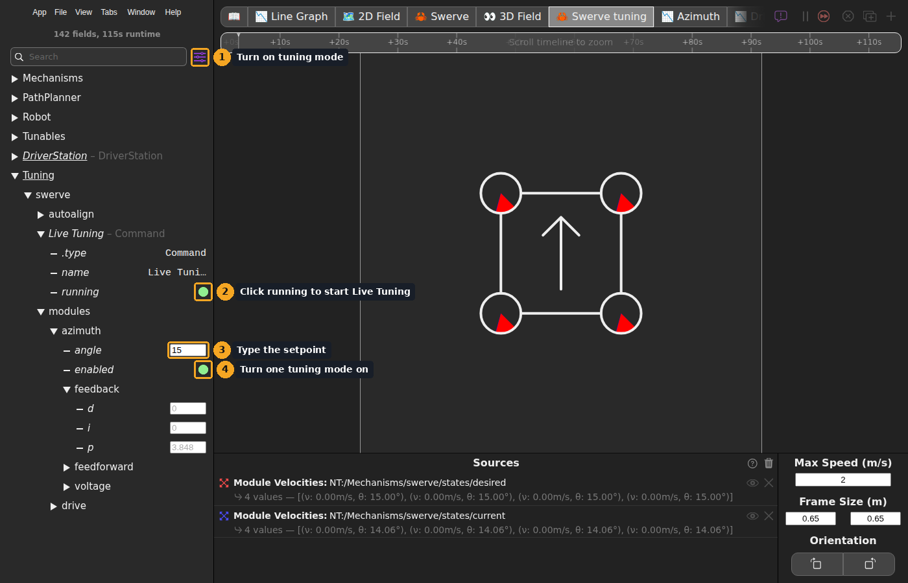
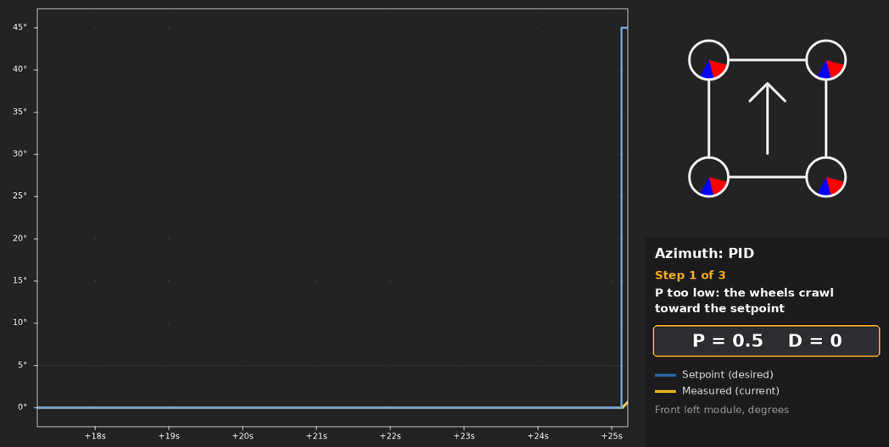
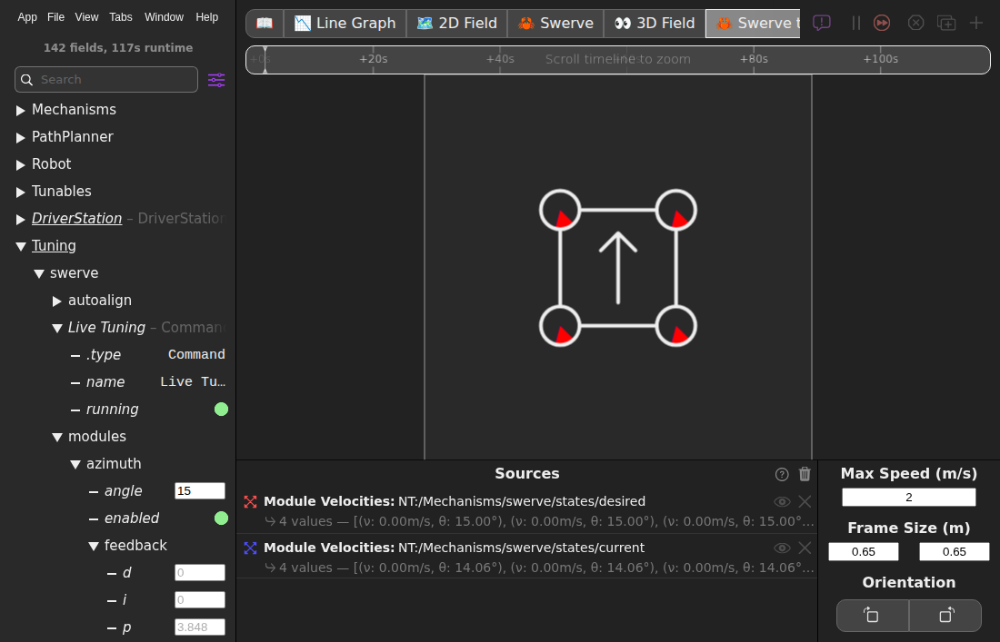
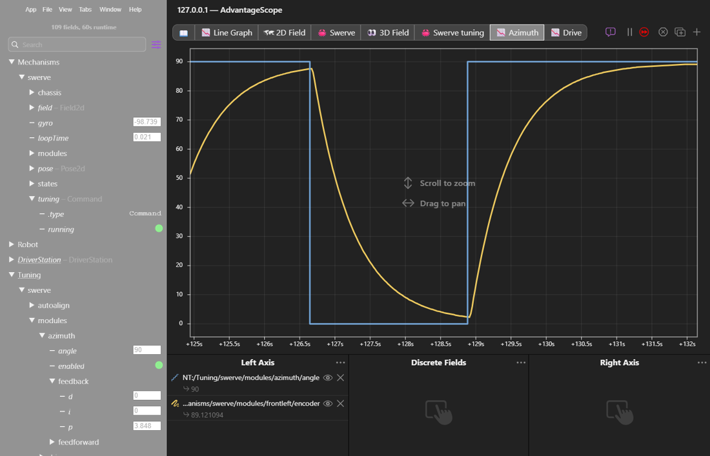
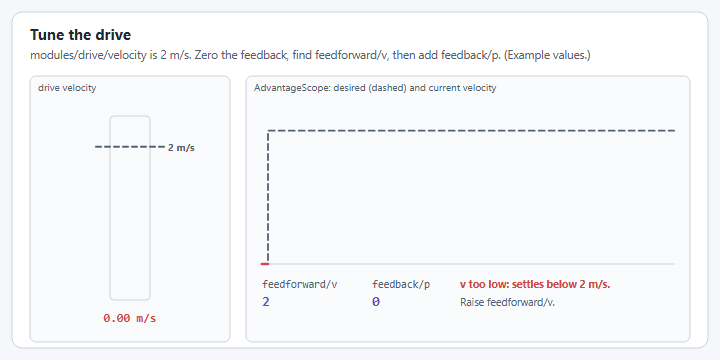
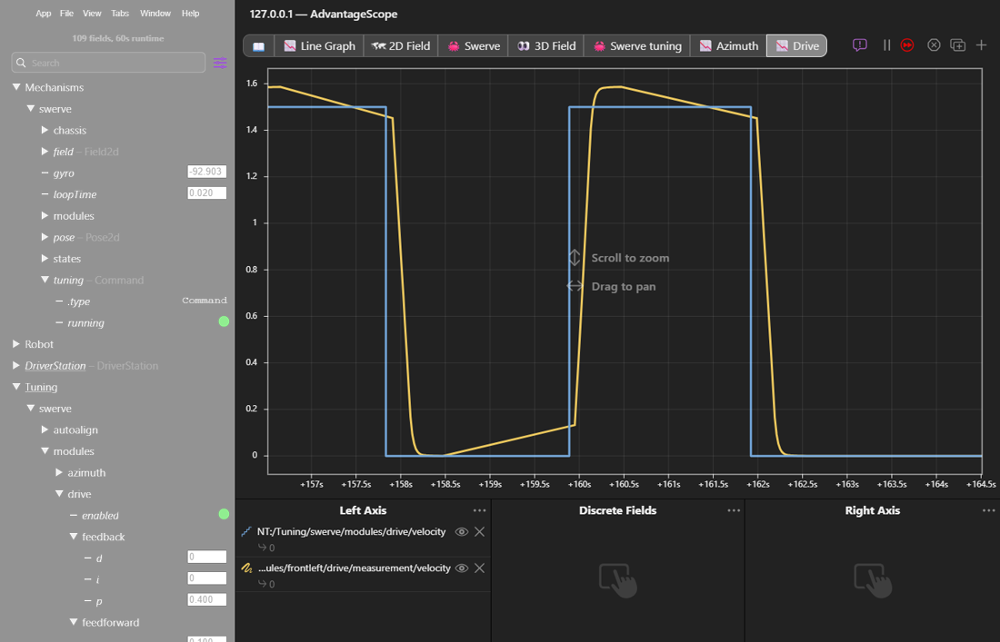
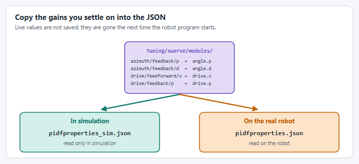

# 5. Practice in simulation

Run the robot program in simulation and go through live tuning once before you touch the real
robot. Simulation is practice, not tuning: the gains it finds can't be trusted on the real modules,
but it teaches you the dashboard and catches config mistakes while nothing can break. You'll do the
same live tuning for real in [step 7](05-deploy-and-drive.md).

Live tuning needs `TelemetryVerbosity.HIGH` and both drive-to-pose controllers, which the code from
[step 4](write-the-swerve-code.md) already sets. [Tune PIDF gains](../how-to/tune-pidf-gains.md#live-tuning)
explains each piece.

**Start live tuning.** Enable Utility mode, start the `Tuning/swerve/Live Tuning` command, and turn on one tuning mode. `Tuning/swerve/` values only take effect while the command runs.

<figure><figcaption>
In simulation: in the sim GUI's Robot State panel, pick Utility (1), then Enable (2). Leave the OpMode at NONE, because a teleop op mode would drive the modules and fight the tuning.
</figcaption></figure>

<figure><figcaption>
Starting live tuning in AdvantageScope, recorded in simulation.
</figcaption></figure>

<figure><figcaption>
In AdvantageScope: turn on tuning mode (1), click <code>running</code> to start the tuning command (2), turn one tuning mode on (3), then type the setpoint (4).
</figcaption></figure>

**Tune the azimuth first**, so the wheels point where they are told while you tune the drive. Set `Tuning/swerve/modules/azimuth/enabled` to `true` and switch `modules/azimuth/angle` between `0` and `15`. Raise `feedback/p` until the modules snap to the angle; if they overshoot and shake, back it off and add a little `feedback/d`.

<figure><figcaption>
Too slow, ringing, then quick and settled. The values are only an example.
</figcaption></figure>

<figure><figcaption>
The real thing: azimuth tuning in AdvantageScope, every module at 15°.
</figcaption></figure>

<figure><figcaption>
Graph Tuning/swerve/modules/azimuth/angle against a module's encoder to judge the gains.
</figcaption></figure>

**Then tune the drive.** Turn azimuth tuning off and set `modules/drive/enabled` to `true` with `modules/drive/velocity` at `2`. Zero `feedback/p`, raise `feedforward/v` until the velocity settles on 2 m/s, then add `feedback/p` until it gets there quickly and holds.

<figure><figcaption>
Feedforward first, then feedback. The values are only an example.
</figcaption></figure>

<figure><figcaption>
Graph Tuning/swerve/modules/drive/velocity against a module's drive/measurement/velocity.
</figcaption></figure>

**Save what you find.** Values typed on the dashboard are gone the next time the robot program starts. In simulation, copy them into `pidfproperties_sim.json`, which YAGSL reads only in simulation.

<figure><figcaption>
Where the live values belong.
</figcaption></figure>

[YAMS' live tuning page](https://yams.yassrobotics.com/documentation/understanding/live-tuning#swerve-drive) covers every swerve tuning key, `feedforward/s`, and auto-align tuning.

Next: [check and calibrate your hardware](04-verify-and-calibrate-hardware.md).
